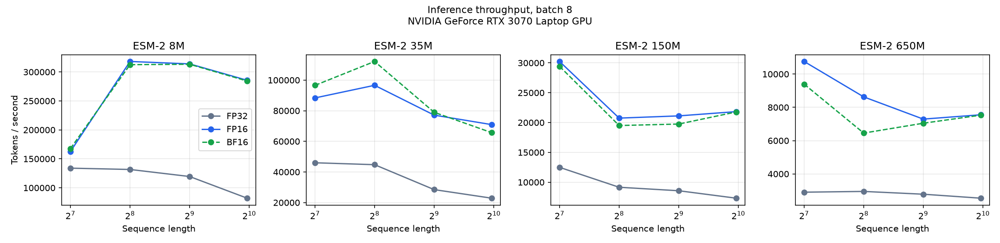
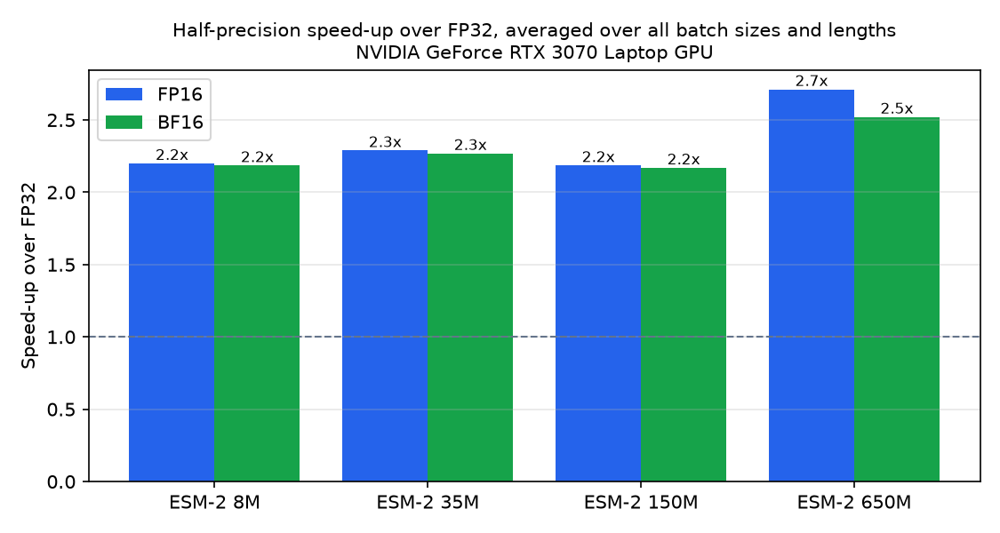
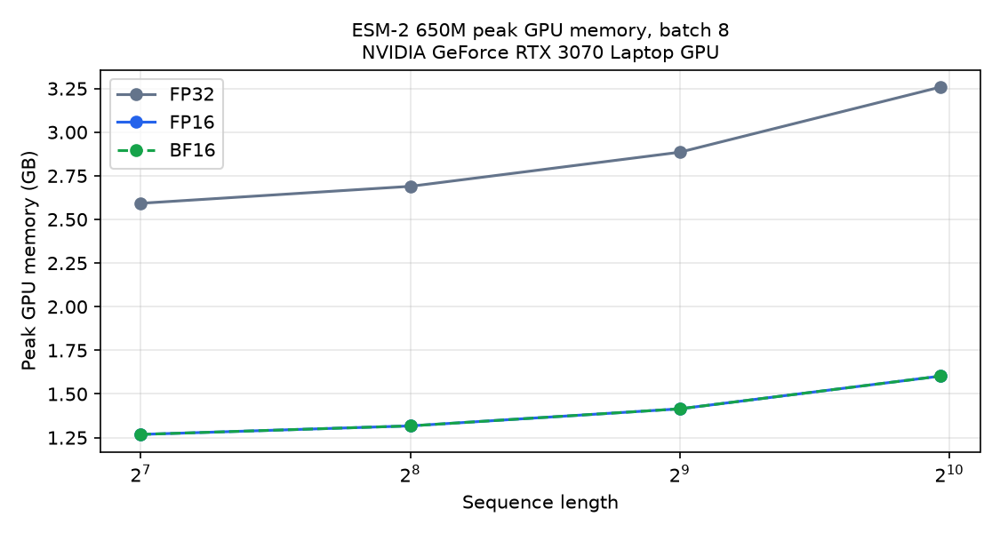
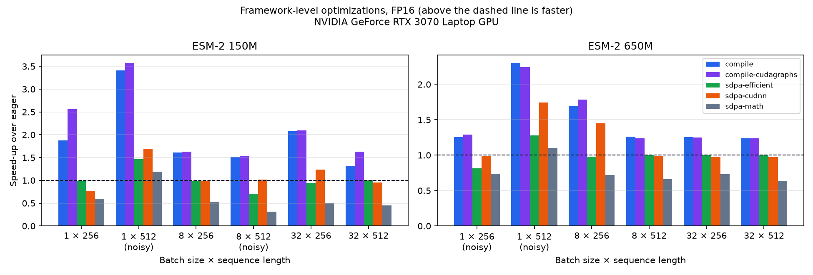
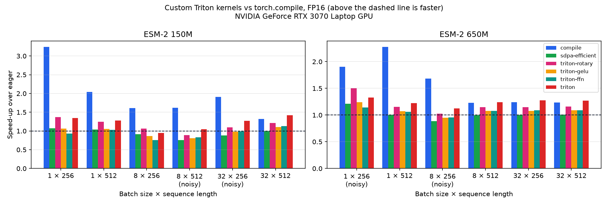

# ProteinPerf

[](https://github.com/salmansystech/ProteinPerf/actions/workflows/ci.yml)

**Profiling and optimizing protein language model inference on GPUs.**

ProteinPerf measures where the time goes when running [ESM-2](https://github.com/facebookresearch/esm), Meta's family of protein language models, and then makes it faster, step by step: from careful baselines and operator-level profiling, through framework-level optimization (`torch.compile`, mixed precision, attention kernels), to custom GPU kernels written in Triton.

Every optimization is measured against the same baseline on the same hardware, with the results, charts and methodology in this repository.

## Why

Protein language models like ESM-2 are used across drug discovery and biology to turn amino acid sequences into embeddings that predict structure, function and mutation effects. Screening millions of proteins makes inference cost a real bottleneck, so understanding and reducing it matters:

- **How fast is it, really?** Latency, throughput and memory across model sizes (8M to 650M parameters), precisions, batch sizes and sequence lengths.
- **Where does the time go?** GPU time broken down into matrix multiplies, attention, LayerNorm, activations, elementwise and memory operations.
- **What actually helps?** Each optimization isolated and measured, so its real effect is known.

## Features

| | |
|---|---|
| **Benchmarking** | GPU timing with CUDA events, warm-up runs, median and p90 latency, throughput in sequences and tokens per second, peak GPU memory, and out-of-memory handling |
| **Profiling** | PyTorch Profiler breakdown by operator category, the slowest operators, and a full trace you can open in Perfetto |
| **Optimization** | `torch.compile`, CUDA graphs, attention backends and length-aware batching, each checked for accuracy against eager mode |
| **Custom GPU kernels** | Triton kernels for rotary embeddings, GELU and a matmul with fused bias + GELU, tested against PyTorch and benchmarked against PyTorch, `torch.compile` and cuBLAS |
| **Reporting** | Throughput, speed-up and memory charts, plus Markdown summary tables |
| **Reproducibility** | Every result records the GPU, driver, CUDA, PyTorch and Transformers versions and the benchmark settings |
| **Realistic inputs** | Synthetic proteins with natural amino acid composition (UniProtKB/Swiss-Prot), or your own FASTA file |
| **Tested** | Unit tests with a tiny in-memory ESM model, so CI runs without a GPU or downloads |

## Quick start

Requires Python 3.10+ and, for GPU results, an NVIDIA GPU with a recent driver.

```bash
git clone https://github.com/salmansystech/ProteinPerf.git
cd ProteinPerf

python -m venv venv
venv\Scripts\activate              # Windows
# source venv/bin/activate         # macOS / Linux

pip install torch --index-url https://download.pytorch.org/whl/cu128
pip install -r requirements.txt
```

Check that PyTorch can see your GPU:

```bash
python -m proteinperf info
```

Then measure, profile and chart:

```bash
# Latency, throughput and memory for several models and settings
python -m proteinperf benchmark --models 8M,35M,150M --dtypes fp32,fp16,bf16 --batch-sizes 1,8,32 --seq-lens 128,256,512

# Where GPU time goes in one configuration
python -m proteinperf profile --model 150M --dtype fp16 --batch-size 8 --seq-len 512

# Compare torch.compile, CUDA graphs and attention backends with eager mode
python -m proteinperf optimize --models 150M --dtype fp16

# Compare batching strategies on 1,000 real proteins
python -m proteinperf batching --model 150M --dtype fp16

# Microbenchmark the custom Triton kernels
python -m proteinperf kernels --models 150M,650M

# Charts and summary tables from the results
python -m proteinperf report --input results/benchmark.json
```

Model weights download automatically from Hugging Face the first time each model is used (31 MB for 8M, up to 2.6 GB for 650M).

Full setup instructions, including WSL2 for the Triton work, are in the [Developer Guide](docs/DEVELOPER_GUIDE.md).

## Commands

| Command | What it does | Key options |
|---|---|---|
| `info` | GPU, compute capability, CUDA, BF16 support and library versions | |
| `benchmark` | Times every combination of the given settings and saves CSV and JSON results | `--models`, `--dtypes`, `--batch-sizes`, `--seq-lens`, `--warmup`, `--iters`, `--output` |
| `profile` | GPU time by operator category and the slowest operators, plus a trace file | `--model`, `--dtype`, `--batch-size`, `--seq-len`, `--iters` |
| `optimize` | Compares `torch.compile`, CUDA graphs and attention backends with eager mode, including accuracy | `--models`, `--dtype`, `--variants`, `--batch-sizes`, `--seq-lens` |
| `batching` | Compares batching strategies on real proteins of different lengths | `--fasta`, `--limit`, `--model`, `--dtype`, `--batch-size`, `--max-tokens` |
| `kernels` | Microbenchmarks the custom Triton kernels against PyTorch eager and `torch.compile` | `--models`, `--dtype`, `--batch-size`, `--seq-len` |
| `report` | Charts and Markdown tables for all results | `--input`, `--optimizations`, `--batching`, `--kernels`, `--kernel-variants`, `--output-dir` |

Run `python -m proteinperf <command> --help` for every option.

| Model | Hugging Face name | Layers | Hidden size |
|---|---|---|---|
| `8M` | `facebook/esm2_t6_8M_UR50D` | 6 | 320 |
| `35M` | `facebook/esm2_t12_35M_UR50D` | 12 | 480 |
| `150M` | `facebook/esm2_t30_150M_UR50D` | 30 | 640 |
| `650M` | `facebook/esm2_t33_650M_UR50D` | 33 | 1280 |
| `3B` | `facebook/esm2_t36_3B_UR50D` | 36 | 2560 |

Precisions: `fp32`, `fp16`, `bf16`. Sequences can be up to 1022 residues long.

## Results

<!-- RESULTS:START -->
### Baseline (phase 1)

Measured on an **NVIDIA GeForce RTX 3070 Laptop GPU** (8 GB, Ampere, compute capability 8.6) with PyTorch 2.11, CUDA 12.8 and Transformers 5.21 on Windows 11. 144 configurations: 4 model sizes × 3 precisions × batch sizes 1, 8 and 32 × sequence lengths 128, 256, 512 and 1000. Each result is the median of 10 timed runs after 3 warm-up runs. Raw data: [`results/baseline.csv`](results/baseline.csv) and [`results/baseline.json`](results/baseline.json).

**Throughput and memory at batch 8, length 512**

| Model | FP32 seq/s | FP16 seq/s | BF16 seq/s | FP32 memory | FP16 memory | BF16 memory |
|---|---|---|---|---|---|---|
| ESM-2 8M | 232.5 | 610.8 | 609.6 | 0.13 GB | 0.07 GB | 0.07 GB |
| ESM-2 35M | 55.4 | 150.0 | 153.6 | 0.28 GB | 0.15 GB | 0.15 GB |
| ESM-2 150M | 16.7 | 41.1 | 38.4 | 0.76 GB | 0.38 GB | 0.38 GB |
| ESM-2 650M | 5.4 | 14.2 | 13.7 | 2.89 GB | 1.41 GB | 1.41 GB |



| | |
|---|---|
|  |  |

**Where GPU time goes** (batch 8, length 512; full profiles in [`results/profiles/`](results/profiles/))

| Category | 150M FP32 | 150M FP16 | 650M FP16 |
|---|---|---|---|
| Matmul | 163.7 ms (49%) | 53.7 ms (43%) | 214.1 ms (59%) |
| Attention | 94.1 ms (28%) | 14.9 ms (12%) | 20.1 ms (6%) |
| Elementwise | 59.3 ms (18%) | 36.4 ms (29%) | 82.5 ms (23%) |
| Memory | 5.5 ms (2%) | 14.1 ms (11%) | 31.0 ms (9%) |
| Activation (GELU) | 7.8 ms (2%) | 4.0 ms (3%) | 8.8 ms (2%) |
| LayerNorm | 4.6 ms (1%) | 2.5 ms (2%) | 4.8 ms (1%) |
| **Total GPU time** | **335.0 ms** | **125.6 ms** | **361.3 ms** |

### Key findings

1. **Half precision is 2.2–2.7× faster and halves memory.** Averaged over all batch sizes and lengths, FP16 is 2.2× faster on the smaller models and 2.7× faster on 650M, where the matrix multiplies dominate and run on tensor cores. FP16 and BF16 perform almost identically on this Ampere GPU, so BF16's wider numeric range comes at almost no cost.
2. **FP32 doesn't fit the largest workloads.** ESM-2 650M in FP32 at batch 32 × 1000 residues exceeded the 8 GB GPU. On Windows the NVIDIA driver spilled into system RAM instead of failing, making it about 11× slower than expected, so that result is flagged and excluded. The same workload in FP16 needs 2.8 GB.
3. **Half precision moves the bottleneck to elementwise operations.** Going from FP32 to FP16 on 150M, matmuls get 3.0× faster and attention 6.3× faster (tensor cores and the fused memory-efficient attention kernel), but elementwise operations only 1.6× faster. They become 29% of GPU time. Most come from the rotary position embeddings (multiply, negate and concatenate on queries and keys in every layer) and the unfused exact GELU (`erf` plus several multiplies and adds). These are memory-bound and are the main target for **kernel fusion** in phase 4.
4. **FP16 adds extra copies.** The FP16 model runs 192 copy operations per forward pass versus 9 in FP32 (about 6 more per layer), costing 9 ms, most likely data type conversions. Removing them is another phase 4 target.
5. **The GPU is often waiting for the CPU.** For 150M FP16, kernels are busy for 126 ms of the 195 ms forward pass: about a third of the time the GPU sits idle while Python launches hundreds of small kernels. At batch size 1, the 8M model takes 5–7 ms whatever the sequence length, because launching kernels costs more than computing them. This launch overhead is what `torch.compile` and CUDA graphs reduce, the focus of phase 3.
6. **Longer sequences cost more per token.** ESM-2 650M in FP16 drops from 10,800 tokens/s at length 128 to about 7,500 at lengths 512–1000, as attention cost grows with the square of the length.

**About the hardware:** under sustained load, this laptop's GPU ran at about 800–1,700 MHz, below its 2,100 MHz maximum, because of the laptop's power and cooling limits. The numbers reflect this real-world laptop, not a desktop RTX 3070.

### Framework-level optimizations (phase 3)

Each optimization was measured against eager mode **in the same run**, for ESM-2 150M and 650M in FP16, at batch sizes 1, 8 and 32 and lengths 256 and 512. Raw data: [`results/optimizations.csv`](results/optimizations.csv).

| Variant | What it does |
|---|---|
| `compile` | `torch.compile` (Inductor) fuses operators into generated Triton kernels |
| `compile-cudagraphs` | `torch.compile(mode="reduce-overhead")`: also replays the kernels as one CUDA graph |
| `sdpa-efficient` | Forces the memory-efficient attention kernel: **the same kernel eager mode already uses**, so it serves as a noise control |
| `sdpa-cudnn` | Forces cuDNN's attention kernel |
| `sdpa-math` | Forces unfused attention (separate matmul, softmax and matmul) |

**Speed-up over eager mode** (⚠ marks shapes where the noise control deviated from 1.00× by more than 10%, so small differences there aren't meaningful):

**ESM-2 150M**

| Batch × length | Eager | `compile` | `compile-cudagraphs` | `sdpa-efficient` | `sdpa-cudnn` | `sdpa-math` |
|---|---|---|---|---|---|---|
| 1 × 256 | 27.5 ms | 1.88× | 2.56× | 0.98× | 0.77× | 0.60× |
| 1 × 512 ⚠ | 55.1 ms | 3.41× | 3.57× | 1.47× | 1.70× | 1.19× |
| 8 × 256 | 65.3 ms | 1.61× | 1.63× | 0.99× | 0.99× | 0.53× |
| 8 × 512 ⚠ | 132.9 ms | 1.51× | 1.53× | 0.71× | 1.02× | 0.32× |
| 32 × 256 | 304.2 ms | 2.07× | 2.10× | 0.95× | 1.23× | 0.50× |
| 32 × 512 | 720.0 ms | 1.32× | 1.63× | 1.00× | 0.96× | 0.45× |

**ESM-2 650M**

| Batch × length | Eager | `compile` | `compile-cudagraphs` | `sdpa-efficient` | `sdpa-cudnn` | `sdpa-math` |
|---|---|---|---|---|---|---|
| 1 × 256 ⚠ | 30.1 ms | 1.26× | 1.29× | 0.81× | 0.99× | 0.74× |
| 1 × 512 ⚠ | 89.0 ms | 2.30× | 2.24× | 1.28× | 1.75× | 1.10× |
| 8 × 256 | 267.1 ms | 1.69× | 1.78× | 0.98× | 1.45× | 0.72× |
| 8 × 512 | 561.4 ms | 1.26× | 1.24× | 1.00× | 0.99× | 0.66× |
| 32 × 256 | 1043.5 ms | 1.25× | 1.25× | 1.00× | 0.98× | 0.73× |
| 32 × 512 | 2094.6 ms | 1.24× | 1.24× | 1.00× | 0.97× | 0.64× |



**Batching 1,000 real human proteins** (UniProtKB/Swiss-Prot, 16–1,021 residues, median 367; ESM-2 150M FP16, 8 proteins per batch or a 4,096-token budget). Raw data: [`results/batching.csv`](results/batching.csv).

| Strategy | Batches | Total time | Proteins/s | Padding efficiency | Speed-up |
|---|---|---|---|---|---|
| `unsorted` | 125 | 36.6 s | 27.3 | 54% | 1.00× |
| `sorted` | 125 | 19.4 s | 51.4 | 99% | 1.88× |
| `token-budget` | 109 | 19.4 s | 51.5 | 99% | 1.88× |

### Phase 3 findings

Conclusions use only the shapes where the noise control stayed within 10% of 1.00×.

1. **`torch.compile` speeds up ESM-2 by 1.2–2.1× with no code changes.** The whole model compiled as a single graph, with no graph breaks. The smaller 150M model gains more (1.3–2.1×) than 650M (1.2–1.7×), because in the larger model the matrix multiplies, which compiling doesn't change, take a bigger share of the time. Compilation costs 20–28 seconds on the first call.
2. **The embeddings stay the same.** Across all variants and shapes, the lowest per-token cosine similarity with eager mode is 0.998 and the largest mean absolute difference is 0.002, at the level of normal FP16 rounding.
3. **CUDA graphs matter when launch overhead dominates.** For 150M at batch 1 × 256, CUDA graphs raise the speed-up from 1.88× to 2.56×, confirming the phase 1 finding that the GPU was waiting for the CPU. For 650M, whose larger kernels already keep the GPU busy, they add almost nothing.
4. **Fused attention kernels are essential.** Unfused (math) attention is 1.4–2.2× slower than the default kernel, more so for longer sequences. cuDNN attention is not consistently better than the default memory-efficient kernel (0.77–1.45×), and its output differs slightly (maximum absolute difference up to 0.24). FlashAttention is not included in PyTorch's Windows build.
5. **Sorting real proteins by length almost doubles throughput.** With unsorted batches, 46% of computed tokens are padding. Sorting by length brings padding efficiency to 99% and makes the whole dataset **1.88× faster**, with no change to the model. A token budget gives the same speed with 13% fewer batches and 21% lower peak memory (401 MB vs 510 MB), because batch size adapts to sequence length.
6. **Laptop measurements are noisy at some shapes.** The noise control (`sdpa-efficient`, identical to eager) ranged from 0.71× to 1.47× on 4 of the 12 shapes, mostly at batch 1. Building a control into every comparison is what makes this visible, instead of reporting noise as a speed-up.

These optimizations were measured separately. They target different overheads, so they should compound, but their combined effect hasn't been measured yet.

### Custom Triton kernels (phase 4)

Three hand-written [Triton](https://github.com/triton-lang/triton) kernels replace the operations that phase 1 profiling identified as bottlenecks ([how they work](docs/ARCHITECTURE.md#11-custom-triton-kernels-phase-4)):

| Kernel | Replaces |
|---|---|
| **Fused rotary embedding** ([`rotary.py`](proteinperf/kernels/rotary.py)) | Hugging Face's FP32 casts, `rotate_half` (slice, negate, concatenate), multiplies, adds and casts back for queries and keys, in one launch |
| **Fused GELU** ([`gelu.py`](proteinperf/kernels/gelu.py)) | The 5 elementwise operations of ESM-2's exact GELU |
| **Tiled matmul with fused bias + GELU** ([`matmul.py`](proteinperf/kernels/matmul.py)) | The feed-forward up-projection (cuBLAS) and the GELU after it, applying bias and GELU in the matmul's epilogue; autotuned tile sizes |

**Kernel microbenchmarks** at the layer shapes of batch 8 × 512 (FP16). Bandwidth is shown as a percentage of the 357 GB/s measured for a large device-to-device copy, the practical ceiling of this GPU. Raw data: [`results/kernels.csv`](results/kernels.csv).

| Model | Kernel | Eager | torch.compile | Triton | vs eager | vs compile | Throughput | Max diff |
|---|---|---|---|---|---|---|---|---|
| 150M | Rotary embedding | 0.972 ms | 0.068 ms | 0.067 ms | 14.60× | 1.02× | 324 GB/s (91%) | 0.0000 |
| 150M | GELU | 0.667 ms | 0.121 ms | 0.123 ms | 5.43× | 0.98× | 343 GB/s (96%) | 0.0020 |
| 150M | Matmul (feed-forward up-projection) | 0.516 ms | 0.518 ms | 0.495 ms | 1.04× | 1.05× | 27.2 TFLOPS | 0.0000 |
| 150M | Matmul + bias + GELU | 1.205 ms | 0.645 ms | 0.553 ms | 2.18× | 1.17× | 24.4 TFLOPS | 0.0039 |
| 650M | Rotary embedding | 2.005 ms | 0.181 ms | 0.126 ms | 15.92× | 1.44× | 343 GB/s (96%) | 0.0000 |
| 650M | GELU | 1.316 ms | 0.239 ms | 0.242 ms | 5.44× | 0.99× | 348 GB/s (98%) | 0.0020 |
| 650M | Matmul (feed-forward up-projection) | 2.038 ms | 2.018 ms | 2.011 ms | 1.01× | 1.00× | 26.8 TFLOPS | 0.0000 |
| 650M | Matmul + bias + GELU | 3.459 ms | 2.347 ms | 2.631 ms | 1.31× | 0.89× | 20.5 TFLOPS | 0.0039 |

The eager matmul is cuBLAS, so the matmul rows compare the Triton kernel directly with NVIDIA's library.

**Whole-model speed-up over eager** (FP16; ⚠ marks shapes where the noise control deviated by more than 10%). `triton` combines the rotary kernel and the fused feed-forward kernel. Raw data: [`results/kernel_variants.csv`](results/kernel_variants.csv).

**ESM-2 150M**

| Batch × length | Eager | `compile` | `sdpa-efficient` | `triton-rotary` | `triton-gelu` | `triton-ffn` | `triton` |
|---|---|---|---|---|---|---|---|
| 1 × 256 | 37.7 ms | 3.24× | 1.07× | 1.37× | 1.06× | 0.93× | 1.34× |
| 1 × 512 | 39.5 ms | 2.04× | 1.04× | 1.25× | 1.05× | 1.03× | 1.28× |
| 8 × 256 | 65.5 ms | 1.61× | 0.91× | 1.06× | 0.86× | 0.76× | 0.95× |
| 8 × 512 ⚠ | 142.7 ms | 1.62× | 0.76× | 0.89× | 0.81× | 0.83× | 1.04× |
| 32 × 256 ⚠ | 292.0 ms | 1.91× | 0.88× | 1.10× | 0.98× | 0.99× | 1.27× |
| 32 × 512 | 719.6 ms | 1.32× | 1.00× | 1.22× | 1.11× | 1.13× | 1.42× |

**ESM-2 650M**

| Batch × length | Eager | `compile` | `sdpa-efficient` | `triton-rotary` | `triton-gelu` | `triton-ffn` | `triton` |
|---|---|---|---|---|---|---|---|
| 1 × 256 ⚠ | 47.5 ms | 1.91× | 1.21× | 1.50× | 1.24× | 1.14× | 1.33× |
| 1 × 512 | 89.2 ms | 2.28× | 1.00× | 1.16× | 1.07× | 1.06× | 1.22× |
| 8 × 256 ⚠ | 240.6 ms | 1.68× | 0.88× | 1.03× | 0.95× | 0.95× | 1.12× |
| 8 × 512 | 559.9 ms | 1.23× | 1.00× | 1.15× | 1.08× | 1.08× | 1.24× |
| 32 × 256 | 1043.0 ms | 1.24× | 1.00× | 1.15× | 1.08× | 1.09× | 1.27× |
| 32 × 512 | 2110.2 ms | 1.24× | 1.01× | 1.16× | 1.09× | 1.09× | 1.27× |



### Phase 4 findings

1. **The kernels run close to the hardware limit.** The rotary and GELU kernels reach 91–98% of the GPU's measured copy bandwidth. They're memory-bound, so this is about as fast as they can go on this GPU.
2. **The fused rotary kernel is 15× faster than Hugging Face's code and exact.** Its output is identical (cosine similarity 1.000000, mean difference 0), because it does the same FP32 math, without the casts, slices and concatenations. At the 650M shapes it's also 1.44× faster than `torch.compile`'s generated kernel. It also removes the FP32 casts in Hugging Face's rotary code (`q.float()`, `.to(original_dtype)`), which most likely explain the extra copy operations found in phase 1. In the whole model, it speeds up every reliable shape by 1.06–1.37×.
3. **The hand-written matmul matches cuBLAS.** At the feed-forward shapes it runs at 27 TFLOPS, 0.93–2.15× the speed of cuBLAS across all 12 tested sizes and within about 7% where it's slower. Fusing bias and GELU into its epilogue makes the up-projection plus GELU 1.27–2.18× faster than PyTorch in isolation, at every shape.
4. **For the 650M model at batch 8 and above, the custom kernels match `torch.compile` without compiling.** `triton` reaches 1.24–1.27× against `compile`'s 1.23–1.24×, and takes effect immediately instead of after a 5–28 second compilation. For 150M at batch 32 × 512 it's 1.42× against 1.32×.
5. **At small batches, `torch.compile` wins.** At batch 1 it's 2.0–3.2× faster than eager, against 1.2–1.3× for the custom kernels. Compiling fuses every small operation in the model and cuts launch overhead, while the custom kernels only replace the rotary and feed-forward operations. The two approaches are complementary.
6. **Accuracy holds.** The GELU and feed-forward kernels compute GELU in FP32, where Hugging Face computes it in FP16, so their embeddings differ by FP16 rounding (lowest cosine similarity 0.996, mean difference at most 0.003), similar to `torch.compile`.
7. **One result doesn't fit.** For 150M at batch 8 × 256, the GELU and feed-forward kernels made the model 0.76–0.86× as fast, although in isolation both kernels are faster at that exact shape (fused matmul + GELU 1.90×). The noise control also ran 9% slow there, just inside the 10% threshold, so this is most likely noise, but it hasn't been confirmed with a re-run.
<!-- RESULTS:END -->

## Project structure

```
ProteinPerf/
├── proteinperf/
│   ├── cli.py            # Command-line interface (python -m proteinperf)
│   ├── models.py         # ESM-2 model registry and loading
│   ├── sequences.py      # Synthetic proteins and FASTA reading
│   ├── benchmark.py      # Latency, throughput and memory measurement
│   ├── profiling.py      # PyTorch Profiler breakdown by operator category
│   ├── variants.py       # torch.compile, CUDA graphs and attention backend variants
│   ├── batching.py       # Batching strategies for mixed-length proteins
│   ├── kernels/          # Custom Triton kernels: rotary, GELU, matmul with fused epilogue
│   ├── report.py         # Charts and summary tables
│   └── environment.py    # Hardware and software details for each result
├── data/                 # 2,000 real human proteins from UniProtKB/Swiss-Prot
├── tests/                # Unit tests (run on CPU with a tiny ESM model)
├── results/
│   ├── baseline.csv/.json # Raw benchmark data with environment metadata
│   ├── optimizations.csv/.json, batching.csv/.json  # Phase 3 results
│   ├── kernels.csv/.json, kernel_variants.csv/.json # Phase 4 results
│   ├── charts/           # Throughput, speed-up and memory charts
│   └── profiles/         # GPU time breakdowns per configuration
├── docs/
│   ├── ARCHITECTURE.md   # How the system works and how it measures
│   └── DEVELOPER_GUIDE.md
└── .github/workflows/    # CI
```

## Roadmap

| Phase | Status | Focus |
|---|---|---|
| 1. Baseline and profiling | ✅ Done | Benchmarks across models, precisions, batch sizes and lengths; operator-level profiling |
| 2. Compute and memory analysis | Planned | FLOPs and bytes per layer, arithmetic intensity, roofline charts |
| 3. Framework-level optimization | ✅ Done | `torch.compile` (Inductor), CUDA graphs, attention backends, length-sorted and token-budget batching |
| 4. Custom Triton kernels | ✅ Done | Fused rotary embedding, fused GELU, and a tiled matmul with fused bias + GELU, compared with PyTorch, `torch.compile` and cuBLAS |
| 5. Profiling assistant | Planned | An LLM agent that explains profiler results and suggests optimizations |
| Future | | AMD GPUs (ROCm), multi-GPU scaling, protein structure models |

The kernels are written in [Triton](https://github.com/triton-lang/triton), which compiles for both NVIDIA (CUDA) and AMD (ROCm) GPUs. They have only been tested on NVIDIA so far.

## Documentation

| Document | Contents |
|---|---|
| [Architecture](docs/ARCHITECTURE.md) | System design, data flow, measurement and profiling methodology, design decisions |
| [Developer Guide](docs/DEVELOPER_GUIDE.md) | Setup on Windows, Linux and WSL2, testing, code conventions, extending the project, getting reliable benchmark numbers, troubleshooting |

## License

MIT License. See [LICENSE](LICENSE).

ESM-2 models are released by Meta under the MIT License. Protein sequences in `data/` come from [UniProt](https://www.uniprot.org) (UniProtKB/Swiss-Prot) under [CC BY 4.0](https://creativecommons.org/licenses/by/4.0/).

## Author

**Salman Khan** - [GitHub](https://github.com/salmansystech)
