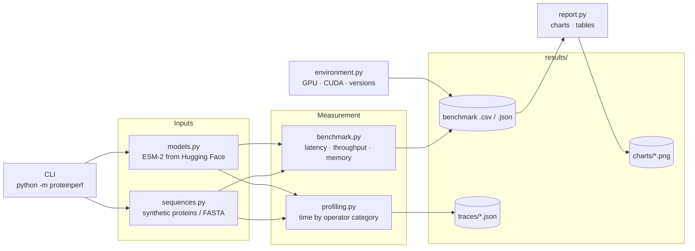
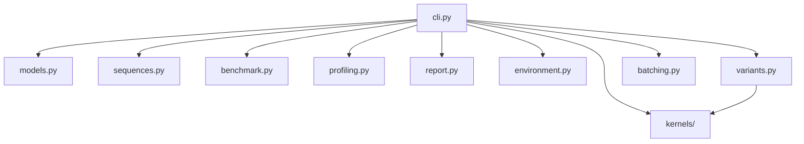
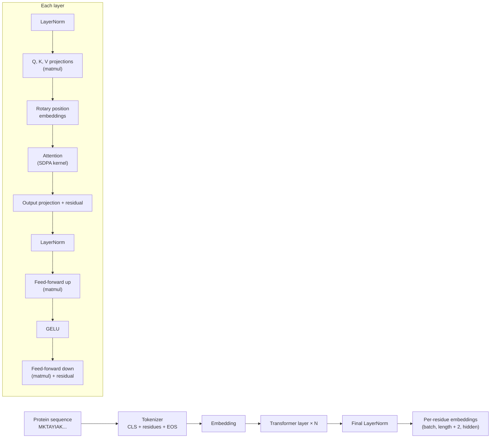
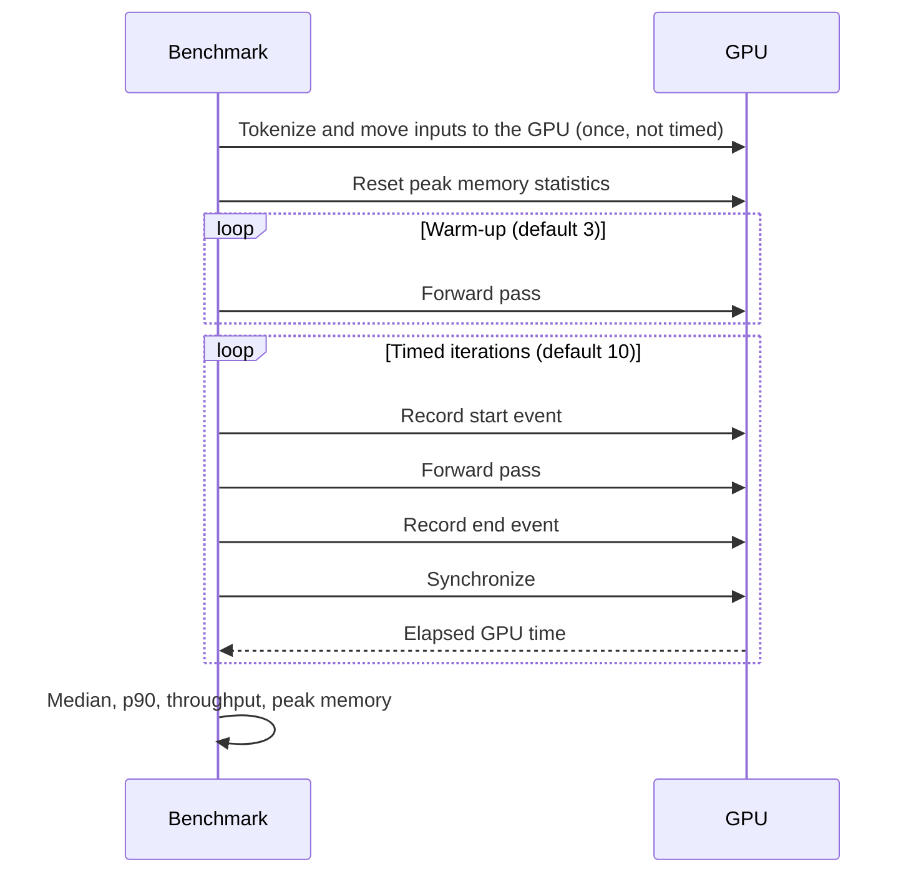
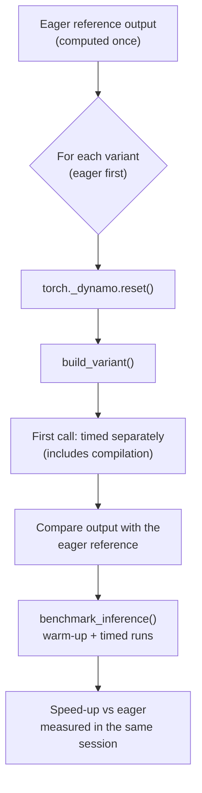
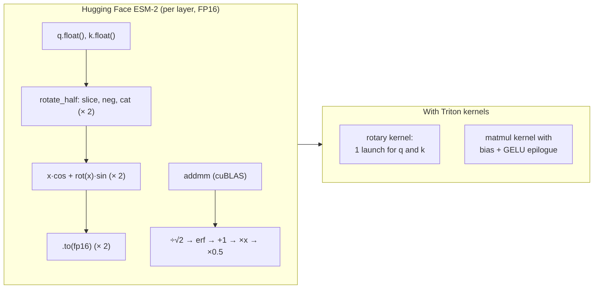
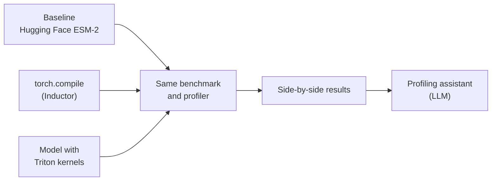

# Architecture

This document explains how ProteinPerf is built and, just as importantly, how it measures. Performance numbers are only useful if the method behind them is sound, so the measurement and profiling methodology is described in detail.

## Contents

1. [System overview](#1-system-overview)
2. [Modules](#2-modules)
3. [The model: ESM-2](#3-the-model-esm-2)
4. [Inputs](#4-inputs)
5. [Benchmark methodology](#5-benchmark-methodology)
6. [Profiling methodology](#6-profiling-methodology)
7. [Results and reporting](#7-results-and-reporting)
8. [Testing strategy](#8-testing-strategy)
9. [Design decisions](#9-design-decisions)
10. [Framework-level optimizations (phase 3)](#10-framework-level-optimizations-phase-3)
11. [Custom Triton kernels (phase 4)](#11-custom-triton-kernels-phase-4)
12. [Planned architecture](#12-planned-architecture)

---

## 1. System overview



There are four commands, each a thin layer over the modules:

| Command | Flow |
|---|---|
| `info` | `environment.py` → console |
| `benchmark` | for each model and precision: `models.py` → for each length and batch size: `sequences.py` → `benchmark.py` → CSV + JSON with environment metadata |
| `profile` | `models.py` + `sequences.py` → `profiling.py` → category breakdown + Perfetto trace |
| `report` | results JSON → `report.py` → PNG charts + Markdown table |

Models are loaded once per model and precision, then reused for every sequence length and batch size, because loading weights is far slower than any measurement.

---

## 2. Modules

| Module | Responsibility | Key functions |
|---|---|---|
| `models.py` | ESM-2 registry, precisions and loading | `ESM2_MODELS`, `DTYPES`, `load_model()` |
| `sequences.py` | Benchmark inputs | `synthetic_sequences()`, `read_fasta()` |
| `benchmark.py` | Timing, throughput and memory | `time_function()`, `benchmark_inference()`, `percentile()` |
| `profiling.py` | Operator-level breakdown | `profile_inference()`, `summarize()`, `categorize()` |
| `report.py` | Charts and tables | `speedups()`, `markdown_table()`, `plot_results()` |
| `environment.py` | Reproducibility metadata | `environment_info()` |
| `variants.py` | Framework-level optimizations (phase 3) | `build_variant()`, `output_difference()`, `VARIANTS` |
| `batching.py` | Batching strategies for mixed-length proteins (phase 3) | `make_batches()`, `padding_stats()`, `run_dataset()` |
| `kernels/` | Custom Triton kernels, model patching and microbenchmarks (phase 4) | `rotary_embedding()`, `gelu()`, `linear()`, `esm_triton_kernels()`, `benchmark_kernels()` |
| `cli.py` | Argument parsing and orchestration | `main()` and one `cmd_*` function per command |



The measurement modules (`benchmark.py`, `profiling.py`) take any PyTorch model and any callable tokenizer. They don't depend on `models.py`, which is what lets the tests run them with a tiny model, and will let later phases measure compiled models and custom kernels with the same code.

---

## 3. The model: ESM-2

ESM-2 is a BERT-style transformer encoder trained on hundreds of millions of protein sequences. Each amino acid is one token.



- ProteinPerf loads it with Hugging Face Transformers (`EsmModel`) without the pooling head, which isn't used for embeddings.
- The output is the per-residue embedding, which is what downstream tasks use.
- Rotary embeddings are computed with several small elementwise operations (multiply, add, negate, concatenate), which shows up clearly in profiles.
- Attention runs through PyTorch's `scaled_dot_product_attention`, which picks a fused kernel (memory-efficient or Flash attention) depending on precision and hardware.

---

## 4. Inputs

**Synthetic sequences** (`synthetic_sequences(count, length, seed)`) draw residues from the 20 standard amino acids, weighted by their frequency in UniProtKB/Swiss-Prot. This gives realistic token statistics, exact control over length, and reproducibility through the seed.

**Equal lengths:** all sequences in a benchmark batch have the same length, so there's no padding. Each configuration measures exactly the work it names. Padding with real, mixed-length data is studied separately in phase 3 (see [section 10](#10-framework-level-optimizations-phase-3)).

**FASTA files** (`read_fasta(path)`) load real proteins, joining multi-line sequences and skipping headers.

**Token count:** the tokenizer adds `<cls>` and `<eos>`, so a sequence of length *L* becomes *L + 2* tokens. Throughput in tokens per second counts these, because the model processes them.

---

## 5. Benchmark methodology

`benchmark_inference()` measures one forward pass over one batch.



| Practice | Why |
|---|---|
| **Warm-up runs** | The first passes include one-off costs: CUDA context setup, cuBLAS heuristics, memory allocator growth and kernel selection. These aren't part of steady-state inference. |
| **CUDA events** | GPU work runs asynchronously. CPU timers like `time.time()` measure when work was queued, not when it finished. Events are recorded on the GPU stream itself and measure actual GPU execution. |
| **Synchronize after each iteration** | Ensures the end event has completed before reading it, so each measurement is one complete forward pass. |
| **Median, not mean** | One slow run (a background process, a clock change) can skew a mean; the median is robust to outliers. **p90** is reported alongside to show variability. |
| **`torch.inference_mode()`** | Disables autograd tracking, as in real inference. |
| **Inputs prepared once** | Tokenization and host-to-device copies are excluded, so the measurement is model compute only. |
| **Peak memory** | `torch.cuda.max_memory_allocated()` after resetting statistics: the most memory the forward passes needed, including activations. |
| **Out-of-memory handling** | A configuration that doesn't fit is reported and skipped, the cache is cleared, and the run continues. |
| **Spill detection** | Windows can silently spill GPU memory into system RAM instead of raising an out-of-memory error. Reserved memory above 90% of the GPU's capacity flags the result as invalid. |
| **Releasing models between runs** | Hugging Face models contain reference cycles, so a deleted model stays in GPU memory until garbage collection runs. The benchmark calls `gc.collect()` before `torch.cuda.empty_cache()` and prints the memory still allocated, so a leak shows up immediately. |
| **Results saved continuously** | Results are written after every configuration, so a long run can be stopped without losing data. |

**Reported metrics**

| Metric | Definition |
|---|---|
| `latency_ms` | Median time for one forward pass of the whole batch |
| `latency_p90_ms` | 90th percentile of the same timings |
| `sequences_per_s` | batch size ÷ median latency |
| `tokens_per_s` | batch size × (length + 2) ÷ median latency |
| `peak_memory_mb` | Peak allocated GPU memory during the measured passes |
| `peak_reserved_mb` | Peak memory reserved by PyTorch's caching allocator (allocated plus cached blocks) |
| `exceeds_gpu_memory` | `True` when reserved memory passed 90% of the GPU's total memory. On Windows, the NVIDIA driver can then spill into system RAM instead of failing, which makes the timing meaningless. Such results are excluded from charts and tables. |

On a CPU (used in tests), `time.perf_counter()` replaces CUDA events and memory is reported as 0.

---

## 6. Profiling methodology

`profile_inference()` runs warm-up passes, then several forward passes under the PyTorch Profiler with CPU and CUDA activity recording.

### Operators, not kernels

The profiler records two kinds of GPU-time events:

| Event | Example | Represents |
|---|---|---|
| PyTorch operator | `aten::addmm` | One operation in the model |
| GPU kernel | `ampere_sgemm_128x64_tn` | The CUDA kernel that operator launched |

A kernel's time also appears as its operator's device time, so counting both double counts the work. ProteinPerf counts only **operators**: CPU-side events with a namespace such as `aten::`. It uses each operator's **self** device time, so a parent operator (`aten::linear`) and its child (`aten::addmm`) aren't counted twice either. Profiler bookkeeping events (for example `Activity Buffer Request`) are excluded.

**Validation:** the profiler's total GPU time per pass closely matches the benchmark's measured latency for the same configuration. Any gap is CPU launch overhead, which the profiler doesn't count as GPU time.

### Categories

Operators are grouped so the breakdown is readable. Names are normalized first (`aten::_to_copy` → `to_copy`, `aten::add_` → `add`), then matched in order:

| Category | Matches |
|---|---|
| Attention | `scaled_dot_product*`, `*flash_attention*`, `*efficient_attention*`, `softmax` |
| Matmul | `mm`, `bmm`, `addmm`, `baddbmm`, `matmul`, `linear`, `*gemm*` |
| LayerNorm | `*layer_norm*` |
| Activation | `gelu`, `erf` (ESM-2's exact GELU uses `erf`), `relu`, `silu`, `tanh` |
| Elementwise | `add`, `mul`, `div`, `sub`, `neg`, `where`, `masked_fill`, `cos`, `sin`, `pow`, `sqrt`, `exp`, ... |
| Memory | `*copy*`, `to`, `contiguous`, `clone`, `cat`, `stack`, `index`, `embedding`, `fill`, `zero`, ... |
| Other | Everything else |

The categories map to optimization strategies: Matmul time responds to precision and tensor cores, Attention to kernel choice, and Elementwise, Activation, LayerNorm and Memory time to **kernel fusion**, the main target for phase 4.

### Trace files

The full trace is saved to `results/traces/` and can be opened at [ui.perfetto.dev](https://ui.perfetto.dev) to see every operator and kernel on a timeline, including gaps where the GPU waits for the CPU.

---

## 7. Results and reporting

`benchmark` writes two files:

- **CSV:** one row per configuration, easy to open in a spreadsheet or pandas.
- **JSON:** the same rows plus metadata (timestamp, GPU, compute capability, CUDA, PyTorch and Transformers versions, warm-up and iteration counts, and seed).

`report` reads the JSON and produces:

| Chart | Shows |
|---|---|
| `throughput.png` | Tokens per second vs sequence length, one panel per model, one line per precision |
| `speedup.png` | Average speed-up of FP16 and BF16 over FP32 per model |
| `memory.png` | Peak memory vs sequence length for the largest model |

It also prints a Markdown table of sequences per second and peak memory, ready for the README.

---

## 8. Testing strategy

| Test file | Covers |
|---|---|
| `test_sequences.py` | Lengths, alphabet, reproducibility, natural composition, FASTA parsing |
| `test_benchmark.py` | Percentiles, warm-up and iteration counts, throughput and token arithmetic |
| `test_profiling.py` | Operator categorization, kernel and bookkeeping events excluded, older PyTorch attribute names, a real profile run |
| `test_report.py` | Speed-up calculation, Markdown table (including OOM cells), chart files |
| `test_variants.py` | Variant construction, attention backend wrapper, output comparison |
| `test_batching.py` | Every strategy covers each sequence once, sorting, token budgets, padding statistics, a dataset run |
| `test_kernels.py` | Each Triton kernel against PyTorch on the GPU (skipped without CUDA) |
| `test_patch.py` | Kernels are swapped in and always restored, variant construction |
| `test_cli.py` | Argument validation |

- **No GPU and no downloads:** `conftest.py` builds a 2-layer ESM model with random weights and a minimal tokenizer, so the real benchmark and profiler code runs on CPU in seconds.
- **CI:** GitHub Actions installs the CPU build of PyTorch and runs the suite on Python 3.11 and 3.13 for every push and pull request.
- GPU results themselves are validated by cross-checking: the profiler total against benchmark latency, and token throughput against sequences per second.

---

## 9. Design decisions

| Decision | Reason |
|---|---|
| **Hugging Face Transformers for the baseline** | It's how most people run ESM-2, so improvements are measured against a realistic starting point. |
| **Measurement code independent of the model** | The same benchmark and profiler measure the baseline, compiled models and custom kernels, so comparisons are fair. |
| **Equal-length synthetic batches** | Isolates the effect of length and batch size; padding is a separate question studied separately. |
| **Median of CUDA-event timings** | The standard approach for GPU benchmarking: precise and robust to outliers. |
| **Operator self time for categories** | Avoids double counting between operators, sub-operators and kernels. |
| **Environment saved with every result** | Performance depends on GPU, driver and library versions; results without them can't be compared or reproduced. |
| **A tiny model for tests** | Tests exercise the real code paths without needing a GPU or network access. |
| **Triton for custom kernels** | Python-level GPU kernels that compile for both NVIDIA and AMD GPUs. |

---

## 10. Framework-level optimizations (phase 3)

Phase 3 adds two modules that reuse the same benchmark code, so every result is directly comparable with eager mode.

### Model variants (`variants.py`)

`build_variant(model, name)` returns the model optimized in one way, without changing its weights:

| Variant | How | Targets |
|---|---|---|
| `eager` | The model as loaded | Baseline |
| `compile` | `torch.compile(model)`: TorchDynamo captures the graph, Inductor generates fused Triton kernels | Elementwise and memory operations that were separate kernels |
| `compile-cudagraphs` | `torch.compile(model, mode="reduce-overhead")`: also records the kernels into a CUDA graph and replays it with a single launch | CPU kernel-launch overhead |
| `sdpa-efficient`, `sdpa-cudnn`, `sdpa-flash`, `sdpa-math` | `AttentionBackendModel` runs the model inside `torch.nn.attention.sdpa_kernel(backend)` | Choice of attention kernel |

The `optimize` command runs them like this for every model and shape:



| Practice | Why |
|---|---|
| **Eager measured in the same run** | Laptop GPU clocks vary between sessions (phase 1 measured 195 ms for a configuration that later took 128 ms), so speed-ups are only valid against a baseline measured minutes apart under the same conditions. |
| **`torch._dynamo.reset()` before each variant** | Each variant and shape gets its own compiled graph, instead of reusing or recompiling one built for another shape. |
| **First call timed separately** | Compilation takes seconds to tens of seconds. It's a one-off cost reported as `first_call_s`, not part of steady-state latency. |
| **Accuracy checked for every variant** | A faster result only counts if the embeddings stay the same. Each variant's output is compared with eager: maximum and mean absolute difference, and the lowest per-token cosine similarity. |
| **Unavailable backends skipped** | FlashAttention isn't included in PyTorch's Windows build. Such variants are reported as not available instead of failing the run. |

### Batching strategies (`batching.py`)

Real proteins vary in length, and every sequence in a batch is padded to the longest one, so padding wastes compute. `make_batches()` implements three strategies:

| Strategy | Batches |
|---|---|
| `unsorted` | A fixed number of sequences, in dataset order |
| `sorted` | A fixed number of sequences, after sorting by length |
| `token-budget` | Sorted, then filled while `sequences × (longest length + 2)` stays within a token budget: many short proteins or a few long ones |

`padding_stats()` reports **padding efficiency**: real tokens divided by tokens actually computed. `run_dataset()` tokenizes all batches first, runs warm-up batches, then times embedding the entire dataset.

The input is `data/uniprot_human_sample.fasta`: 2,000 reviewed human proteins from UniProtKB/Swiss-Prot, randomly sampled (seed 0) from the 89% that fit ESM-2's 1022-residue limit. Lengths range from 8 to 1,021 residues (median 365).

---

## 11. Custom Triton kernels (phase 4)

Phase 1 profiling showed that after switching to FP16, elementwise and memory operations take about 40% of GPU time. They're memory-bound: each one reads a whole tensor from GPU memory and writes a whole tensor back, doing very little math. Phase 4 replaces the biggest of them with **fused** Triton kernels that read their inputs once, do all the math in registers, and write once.

```
proteinperf/kernels/
├── rotary.py   # fused rotary position embedding for q and k
├── gelu.py     # fused exact GELU
├── matmul.py   # tiled matmul with optional fused bias + GELU epilogue
├── patch.py    # swaps the kernels into Hugging Face's ESM-2 at run time
└── bench.py    # microbenchmarks against PyTorch eager and torch.compile
```

### What each kernel replaces



| Kernel | Replaces | Design |
|---|---|---|
| **Rotary** (`rotary.py`) | Per layer: casts of q and k to FP32, `rotate_half` (slice, negate, concatenate), 4 multiplies, 2 adds and 2 casts back | Each program handles 32 (batch, head, position) rows. It loads both halves of q and k plus cos and sin, computes `x1·cos − x2·sin` and `x2·cos + x1·sin` in FP32, and stores the result in the input dtype. It reads strided inputs directly, so the transposed q and k views need no copy. |
| **GELU** (`gelu.py`) | Divide, `erf`, add, multiply, multiply | One flat elementwise kernel: load, compute `x·0.5·(1 + erf(x/√2))` in FP32, store. |
| **Matmul** (`matmul.py`) | cuBLAS `addmm` + the 5 GELU kernels in the feed-forward up-projection | Each program computes a `BLOCK_M × BLOCK_N` output tile, looping over `BLOCK_K` slices with `tl.dot` (tensor cores) and accumulating in FP32. Programs are ordered in groups of 8 row-tiles so concurrent programs share input tiles in the L2 cache. The bias and GELU are applied in the **epilogue**, while the result is still in registers, so the large activation is written to memory once instead of being written and read back by separate GELU kernels. `@triton.autotune` picks tile sizes, pipeline stages and warps per shape. |

### Swapping kernels into the model

Hugging Face's `EsmSelfAttention.forward` calls the module-level function `apply_rotary_pos_emb`, and `EsmIntermediate.forward` calls `gelu`. Both are looked up at call time, so `esm_triton_kernels()` (`patch.py`) replaces them inside a context manager and restores the originals afterwards, even if the model raises an error. The model's code and weights are unchanged.

`TritonKernelModel` (`variants.py`) runs a model inside that context, so each combination of kernels is just another variant for the `optimize` command:

| Variant | Kernels |
|---|---|
| `triton-rotary` | Rotary |
| `triton-gelu` | GELU |
| `triton-ffn` | Matmul with fused bias + GELU (replaces the whole up-projection, including GELU) |
| `triton` | Rotary + matmul with fused bias + GELU |

### Correctness and measurement

- **Correctness tests** (`tests/test_kernels.py`) compare each kernel with PyTorch on the GPU: the head sizes of every ESM-2 model (16, 24, 32 and 64, including a half size of 12 that isn't a power of two), FP16, BF16 and FP32, non-contiguous inputs, and matrix sizes that aren't multiples of the tile size. They're skipped on machines without a CUDA GPU, such as CI.
- **The rotary kernel is exact.** Like Hugging Face, it computes in FP32 and rounds once, so its output matches to the last bit up to fused multiply-add rounding.
- **GELU and the fused matmul differ by FP16 rounding.** They compute GELU in FP32, where Hugging Face computes it step by step in FP16, so the kernels are slightly more accurate.
- **Microbenchmarks** (`kernels` command, `bench.py`) use `triton.testing.do_bench`, which flushes the L2 cache between runs, and compare each kernel with the eager PyTorch code it replaces and with `torch.compile` of that same code.
- **Bandwidth** of the memory-bound kernels is reported as a percentage of the bandwidth measured by a large device-to-device copy: the practical ceiling on this GPU.
- **Whole-model results** use the same `optimize` command as phase 3, with the `sdpa-efficient` noise control.

---

## 12. Planned architecture

Later phases plug into the same measurement pipeline:



| Phase | New modules (planned) |
|---|---|
| 2. Compute and memory analysis | `roofline.py`: FLOPs and bytes per layer from the model configuration, arithmetic intensity, and roofline charts against the GPU's peak compute and bandwidth |
| 5. Profiling assistant | An agent that reads profile reports and explains bottlenecks in plain language |
